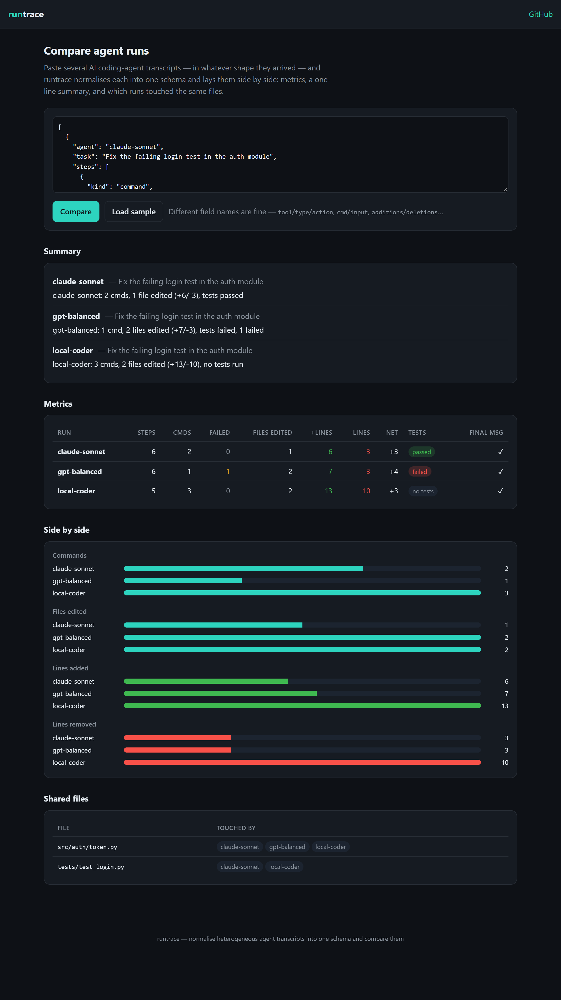

# runtrace

[](https://github.com/BoogeyCodes/runtrace/actions/workflows/ci.yml)


Normalize **AI coding-agent run transcripts** into one schema and **compare runs side by side**.
Different agents log their runs in different shapes; runtrace coerces them into a common `Trace` of
typed steps, computes the numbers an evaluator looks at first — commands run, files edited, lines
changed, whether tests ran and passed — and lays several runs next to each other in the browser.

It's two things: a **zero-dependency library** (the normaliser + metrics), and a **client-side
dashboard** built on it.



## The dashboard

Paste several transcripts (in whatever shape they arrived) and runtrace shows:

- a **per-run metrics table** — steps, commands, failed, files edited, +/- lines, net, tests, final message;
- each run's one-line **summary**;
- **side-by-side bars** comparing commands, edits and lines changed;
- a **shared-files** panel — which runs touched the same files (built on `touchedFiles()`).

```bash
npm install
npm run dev          # open the dashboard locally (Vite)
npm run build:web    # static bundle in web-dist/, deploy anywhere
```

Or with Docker:

```bash
docker build -t runtrace .
docker run -p 8080:80 runtrace     # http://localhost:8080
```

The dashboard is entirely client-side — transcripts never leave the browser.

## The library

```ts
import { normalize, metrics, summarize } from 'runtrace'

const trace = normalize(rawAgentLog)       // -> { agent, task?, steps[], finalMessage? }
metrics(trace)                             // -> { commandCount, filesEdited, testsPassed, ... }
summarize(trace)                           // "agent-a: 4 cmds, 2 files edited (+14/-3), tests passed"
```

**`normalize(input)`** turns a loosely-typed record into a `Trace`:

- Reads the agent from `agent` / `name` / `id`, the task from `task` / `prompt` / `request`, and the
  final message from `finalMessage` / `summary` / `result`.
- Finds the steps under `steps` / `events` / `actions` / `trace`.
- Maps each step's kind from `kind` / `type` / `tool` / `action` (with aliases: `bash`→command,
  `write`→file_edit, …), and **infers** it when absent — a `pytest`/`jest`/`go test` command becomes a
  `test` step, a step with line counts becomes a `file_edit`, a shell-looking string becomes a
  `command`.
- Pulls the command/path/message text and any exit code and added/removed line counts from their
  various field names.

A `Step` is `{ kind, text, exitCode?, added?, removed? }` where kind is one of `command`, `file_edit`,
`file_read`, `message`, `test`, `other`.

**`metrics(trace)`** summarises it:

```ts
{
  stepCount, commandCount, failedCommands,
  filesEdited,   // distinct files
  filesRead, linesAdded, linesRemoved, netLines,
  testRuns, ranTests,
  testsPassed,   // true / false / null (null when no test reported an exit code)
  hasFinalMessage,
}
```

**`summarize(trace)`** gives a one-line human summary, and **`touchedFiles(trace)`** the sorted set of
distinct files a run edited or read — the basis for the dashboard's shared-files panel.

## Install

```bash
npm install runtrace
```

Node 18+. Ships as ESM and CommonJS with type definitions. No runtime dependencies.

## Example

```ts
import { normalize, metrics } from 'runtrace'

const trace = normalize({
  name: 'agent-a',
  prompt: 'Fix the failing login test',
  steps: [
    { tool: 'bash', command: 'npm ci', exitCode: 0 },
    { type: 'edit', path: 'src/auth.ts', additions: 6, deletions: 2 },
    { command: 'npm test', exitCode: 0 },
    'All tests pass now.',
  ],
  summary: 'Fixed the token-expiry comparison; suite is green.',
})

metrics(trace).testsPassed  // true
metrics(trace).filesEdited  // 1
```

## Testing

```bash
npm install
npm test             # normalisation, metrics, and the comparison layer
npm run typecheck    # library    npm run typecheck:web   # dashboard
npm run build        # ESM + CJS + .d.ts via tsup
npm run build:web    # the dashboard bundle via Vite
```

Tests cover field-name mapping, kind inference (test/command/edit), bare-string steps, alternative
container keys, line-count fields, the metrics (dedup, pass/fail/unknown, failed commands), the
summary line, and the comparison layer (per-run cards, shared-file detection, label disambiguation,
bar maxima). CI runs on Linux and Windows across Node 18/20/22.

## Where it fits

runtrace is the normalisation-and-comparison layer in an agent-evaluation workflow: pair it with a
rubric scorer (rate the normalised runs) and a diff view (compare what each changed).

## License

MIT
